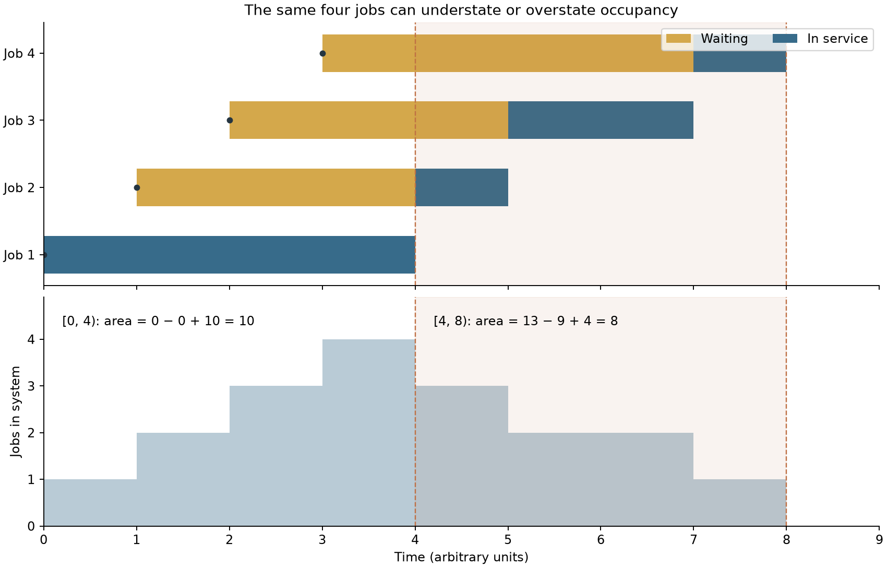
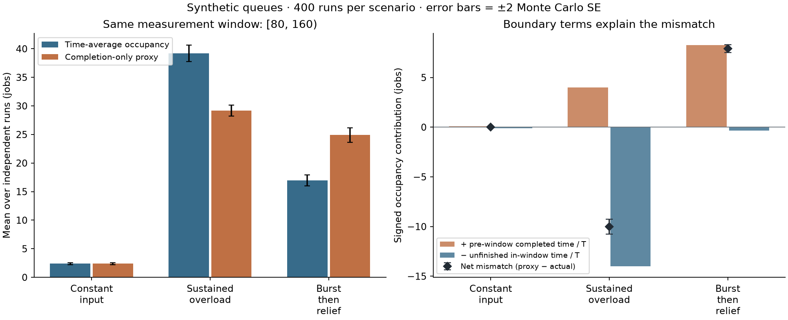

# Finite-window queue audit

[](https://github.com/lcx0731/finite-window-queue-audit/actions/workflows/ci.yml)

**Can throughput × completed-job latency tell you how congested a queue was?**
Not necessarily over a finite window: some completed jobs spent time before the
window, and some jobs inside the window have not completed yet.

This small Python project reconstructs time-average occupancy from observable
job records, exposes both boundary terms, and checks the result independently
by sweeping events. An initially empty FCFS simulator supplies reproducible
synthetic examples; the record-auditing API does **not** require FCFS or
stationarity. It demonstrates discrete-event simulation, sample-path accounting,
careful observation boundaries, and replication-level uncertainty estimates.

All examples use synthetic data. No production telemetry, personal records,
financial returns, or claims about a deployed system are included.



## Run it

Python 3.11 or newer:

```bash
python3 -m venv .venv
source .venv/bin/activate
python -m pip install '.[test]'
python -m pytest -W error
queue-window-audit --output results
```

The CLI runs 400 independent replications for each of three scenarios, checks
all accounting identities, and writes `summary.json` and two PNGs. Defaults:
`--seed 20261020 --replicates 400`. It overwrites the three named output files
inside the chosen output directory; use a new directory to preserve a run.

For the dependency snapshot used to generate the committed results, use
Python 3.13 and install with:

```bash
python -m pip install -c requirements-repro.txt '.[test]'
```

The snapshot records library versions, not a cross-platform binary lockfile.
The wider dependency ranges in `pyproject.toml` are tested in CI on Python 3.11
and 3.13. On the same environment and seed the JSON is deterministic; platforms
and library versions can change last-bit numeric results or plot rendering.

## The finite-window identity

For a window `[l, r)` of length `T`, let job `i` arrive at `a_i` and depart at
`d_i`. Its lifetime is `[a_i, d_i)`. Occupancy is `N(t)`, and total job-time is

```text
I = integral_l^r N(t) dt
  = sum_i max(0, min(d_i, r) - max(a_i, l)).
```

Split jobs into those completing **in** the window and those still incomplete
at its right boundary:

```text
D = {i : l <= d_i < r}          # observed window completions
U = {i : a_i < r <= d_i}        # incomplete strictly before r

C = sum_{i in D} (d_i - a_i)                 # full completed-job sojourns
P = sum_{i in D} max(0, l - a_i)             # their pre-window portions
R = sum_{i in U} (r - max(l, a_i))           # unfinished, in-window job-time

I = C - P + R
L = I / T = C/T - P/T + R/T
```

For a completed job, subtracting its pre-window portion leaves precisely its
in-window exposure. An unfinished job contributes only its elapsed in-window
time. Jobs that depart before `l` or arrive at/after `r` contribute nothing.
Adding these disjoint contributions proves the identity path by path; no
distributional assumptions or long-run limits are needed.

When there is at least one completion, `C/T` is departure rate times mean
completed sojourn. Its signed mismatch with actual occupancy is `(P - R)/T`.
The mismatch can have **either sign**. With no completions, the API reports
`C/T = 0` but returns `None` for mean completed sojourn; it does not invent a
zero mean latency.

This is boundary bookkeeping, not a failure of Little's law. It makes explicit
which finite-window quantities are being combined, rather than asserting that
a completed-customer cohort represents every job present during observation.

### Observation and endpoint contract

- Events at `l` are included; events at `r` have not yet been observed.
- `carry_in_jobs` and `carry_out_jobs` count jobs at **left limits** `l-` and
  `r-`. Thus a departure exactly at `l` is carry-in and a window completion;
  a departure exactly at `r` remains incomplete for this snapshot.
- Counts satisfy `carry_in + arrivals - completions = carry_out` exactly.
- `occupancy_steps` gives post-event counts on positive-length subintervals.
  Its time integral is unaffected by endpoint values. Simultaneous events are
  grouped, so tied arrivals, departures, and zero-length lifetimes are safe.
- Historical arrival timestamps of carry-in jobs must be retained. Incomplete
  jobs need an arrival and incomplete status, **not their future departure**.

For an FCFS trace, a separate check decomposes system job-time into waiting
job-time plus server busy time, with busy time at most `T`.

## Two exact counterexamples

Arrivals `[0, 1, 2, 3]` and services `[4, 1, 2, 1]` produce starts
`[0, 4, 5, 7]` and departures `[4, 5, 7, 8]`.

| Window | Completed sum C | Pre-window P | Unfinished R | Area I | Proxy C/T | Actual I/T |
|---|---:|---:|---:|---:|---:|---:|
| `[0, 4)` | 0 | 0 | 10 | 10 | 0 | 2.5 |
| `[4, 8)` | 13 | 9 | 4 | 8 | 3.25 | 2 |
| `[0, 9)` | 18 | 0 | 0 | 18 | 2 | 2 |

The first window has zero observed completions despite nonzero congestion.
The draining window has a large contribution from time spent **before** it.
The last window contains all complete lifetimes, so neither correction remains.

## Replicated synthetic experiment

Every run starts empty at time zero and is measured on `[80, 160)`. Service
durations are independent exponential draws with mean 1 time unit. Arrivals
are piecewise Poisson: draw each segment's Poisson count, then sorted uniform
timestamps conditional on that count. Seed streams use
`SeedSequence([seed, scenario_index, replicate_index])`.

The first 80 time units provide history, **not a claim of stationarity or an
automatically sufficient warm-up**. The sustained-overload case intentionally
has arrival rate above service capacity. These are finite-horizon experiments,
not steady-state estimates or predictions of real systems.

| Scenario | Arrival rates: `[0,80)` → `[80,160)` | Mean actual occupancy | Mean proxy | Mean mismatch ± MCSE |
|---|---|---:|---:|---:|
| Constant input | 0.70 → 0.70 | 2.3921 | 2.3970 | +0.0049 ± 0.0178 |
| Sustained overload | 1.30 → 1.30 | 39.1998 | 29.1858 | −10.0139 ± 0.3679 |
| Burst then relief | 1.50 → 0.25 | 16.9758 | 24.8918 | +7.9160 ± 0.2002 |

Numbers above are computed from the committed default run, not external
measurements. The corrected quantity equals actual occupancy on each path up
to floating-point rounding. The maximum absolute error over the overlap,
event-sweep, boundary-correction, and waiting/busy checks was approximately
`9.10e-13` job-time units across the 1,200 simulated paths and exact examples.



MCSE is the sample standard deviation of a **run-level** quantity divided by
the square root of 400. For mismatch, the proxy and actual occupancy are
differenced within the same run before estimating MCSE. Individual customer
sojourns are not treated as independent observations. Plot error bars are
±2 MCSE, a simulation-precision illustration, not guaranteed 95% intervals or
uncertainty bands for real-world deployment. The constant-input result is
consistent with a near-zero average mismatch here; this does not make its
per-window boundary terms identically zero.

## Use the audit without a simulator

```python
import numpy as np
from queue_audit import audit_observations

# At cutoff 5, jobs arriving at 0 and 2 remain unfinished.
# The job arriving at 1 completed at 3. Rows need not be sorted.
report = audit_observations(
    arrivals=[0, 1, 2],
    observed_departures=[np.nan, 3, np.nan],
    left=2,
    right=5,
)
assert report.system_area == 7
assert report.completed_sojourn_sum == 2
assert report.prewindow_completed_area == 1
assert report.unfinished_window_area == 6
assert report.conservation_residual == 0
print(report.to_dict())
```

Pass every job whose lifetime intersects the window, including departures
exactly at the left endpoint for the count convention. Fully completed jobs
strictly before the window may also be included and contribute nothing.
Departures at/after the cutoff must be `np.nan`, and arrivals at/after it must
be omitted. The API rejects future timestamps rather than silently using
them. `audit_window(trace, l, r)` performs this censoring before invoking the
same observation-only API.

The correction reconstructs **observed occupancy**. It does not estimate the
eventual mean latency of unfinished jobs: no unobserved residual service or
future wait is inferred.

## Validation and implementation

There are **68 pytest cases**, including a test that enumerates all 540
three-job traces with ordered arrivals in `{0,1,2,3}` and services in
`{0,1,2}`. Independent checks include:

- An O(n²) max-plus completion-time oracle against the O(n) FCFS recurrence.
- Integer-grid occupancy counts across four windows per enumerated trace,
  independent of both clipped overlaps and sorted event integration.
- Hand-computed carry-in/carry-out corrections; empty and zero-completion
  windows; ties and zero services; area partition additivity.
- Time scaling/translation, record permutation, and invariance to changes in
  unobserved future service durations or later arrivals.
- Reproducible scenario streams, paired MCSE calculations, CLI output generation,
  and invalid-input/overflow rejection. Warnings are test failures.

`src/queue_audit/core.py` holds the simulator, observation API, and two area
calculations. `experiment.py` contains synthetic generation, run-level
aggregation, and figures. `results/summary.json` stores all reported numbers.
The event sweep costs O(n log n) time and O(n) memory; the simulator and
overlap sums cost O(n). This is an in-memory reference, not a streaming engine.

## Limits

- Correct accounting requires complete, correctly matched arrival/departure
  records. Missing jobs, duplicate rows, mismatched clocks, and departures
  incorrectly marked incomplete are not identifiable from these arrays alone.
  A self-consistent identity does not prove telemetry completeness.
- The simulator has one nonpreemptive, work-conserving FCFS server, unlimited
  waiting space, no rejection or abandonment, and input-order tie breaking.
  The exposure identity itself is more general than that simulator.
- All times are nonnegative float64 values. Use relative times in a sensible
  unit: subtracting nearly equal large timestamps or boundary sums can lose
  precision. A positive service too small to advance its start timestamp and
  overflowing completions/integrals are rejected. “Exact” means algebraic
  equality in real arithmetic, not arbitrary-precision computation.
- Poisson arrivals, exponential service, three selected demand patterns, and
  one default seed are illustrative choices, not calibrated models or a
  universal ranking of monitoring metrics. No steady-state convergence test,
  latency-distribution estimator, or production log parser is provided.

## Background references

- Larson and Odoni, *Urban Operations Research*,
  [Section 4.4: Some Important Relationships in Queueing Theory](https://web.mit.edu/urban_or_book/www/book/chapter4/4.4.html):
  the area-under-occupancy viewpoint and its relation to Little's formula.
- MIT OpenCourseWare, [queueing lecture notes for 1.203J](https://ocw.mit.edu/courses/1-203j-logistical-and-transportation-planning-methods-fall-2006/resources/lec5/):
  queueing notation, Little's law, and dynamic behavior.

The finite-window derivation, code, tests, and figures in this repository are
an original educational implementation, not a new queueing theorem or copied
course solution. Licensed under [MIT](LICENSE).
